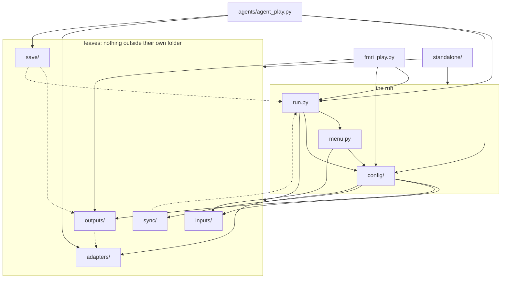
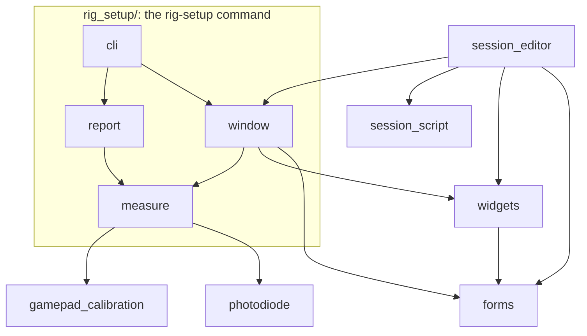

# How the modules of `fmri_gym` depend on each other

The package is in three layers, and an import only ever points down:

1. **Leaves**: `inputs/`, `outputs/`, `sync/`, `save/` and `adapters/`. A leaf imports nothing from outside its own folder at run time, so each can be read, tested and reused alone.
2. **The run**: `config/`, `menu.py` and `run.py`, which put the leaves together into one session. `config/` reads the leaves' checks and types; `run.py` drives them.
3. **Standalone tools**: `standalone/`, the commands that are not a run (rig setup, gamepad calibration, the session editor, the photodiode test). They may import anything below them, and nothing outside `standalone/` imports from it.

The top-level `fmri_gym/__init__.py` imports nothing, so importing one leaf loads only that leaf.

## The layers

An arrow is "imports at run time". A dotted arrow is an import made only for type hints (under `TYPE_CHECKING`), which loads nothing when the code runs.

## Module by module

What each module of the run and the leaves imports at run time from another folder or file of `fmri_gym` (imports inside its own folder are left out of the leaves' rows):

| module | imports |
|---|---|
| `run.py` | `menu`, `config/run`, `config/curriculum`, `config/phases`, `adapters`, `inputs`, `outputs/display`, `outputs/audio`, `sync/triggers`, `save/logging`, `save/bids` |
| `menu.py` | `config/phases` (`MenuSettings`), `inputs` |
| `config/run.py` | `config/curriculum`, `config/phases`, `config/rig`, `adapters` (`get_adapter`), `inputs` |
| `config/curriculum.py` | `config/phases` |
| `config/phases.py` | `inputs`, `outputs/display` (`image_line_problems`) |
| `config/rig.py` | `inputs`, `sync/triggers` (`TriggerSettings`) |
| `save/bids.py`, `save/replay.py` | `save/logging` |
| `adapters/<backend>.py` | `adapters/base`, which imports `adapters/keymap` |
| `inputs/`, `outputs/`, `sync/` | nothing outside their folder |

## Inside `standalone/`

Each of these also imports from the layers below: `rig_setup/measure.py` reaches into the run's display, audio, triggers and inputs to time them, and `session_script.py` reads a rig and the data folder (`config/rig`, `save/bids`).

## Keeping it this way

A new import that points up a layer, or into `standalone/` from outside it, is the thing to avoid. Move the shared piece down instead, into the leaf or into `config/`, as `MenuSettings` sits in `config/phases.py` so that the config layer need not import the menu; or pass what a leaf needs from above as an argument, as `save.replay.reconstruct_episode` takes the adapter rather than building one.
