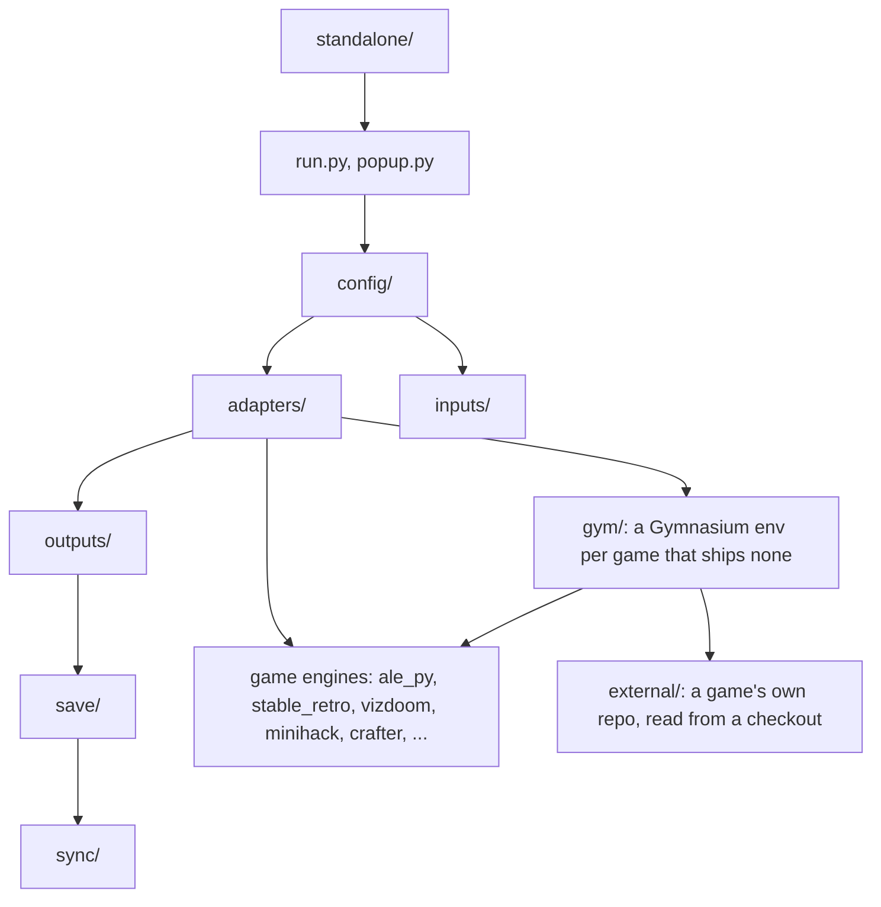
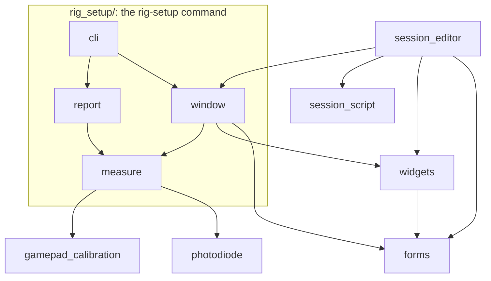

# How the modules of `humans` depend on each other

The package is a stack of layers, and an import only ever points down, type hints included. `uv run lint-imports` checks it on every pull request, from the contracts in `pyproject.toml` (`[tool.importlinter]`).

From the top:

1. **`standalone/`**: the commands that are not a run (rig setup, gamepad calibration, the session editor, the photodiode test). They may import anything below them; nothing outside `standalone/` imports from it.
2. **`run.py`, then `popup.py`**: one run's loop, and the pop-ups it opens (the pause menu, the hint).
3. **`config/`**: the curriculum, the rig config and the run config, checked against the leaves below.
4. **The leaves, an ordered stack**: `adapters/` over `outputs/` over `save/` over `sync/`; `inputs/` sits beside `sync/` and imports none of them. Each leaf imports only the leaves below it, so `sync/` and `inputs/` can be read, tested and reused alone.
5. **Below `adapters/`**: the game engines and the `gym/` packages, which only `adapters/` imports. A `gym/` package imports no `humans` and no other `gym/` package but the one it is built on (`coom_gym` on `vizdoom_gym`). Only a `gym/` package reads `external/`, which is reached by path or compiled rather than imported by name, so the linter cannot see it and the rule is kept by review.

The top-level `humans/__init__.py` imports nothing, so importing one leaf loads only that leaf and the ones below it.

## Module by module

What each module imports from another folder or file of `humans` (imports inside its own folder are left out):

| module | imports |
|---|---|
| `run.py` | `menu`, `config/run`, `config/curriculum`, `config/phases`, `adapters`, `inputs`, `outputs/display`, `outputs/audio`, `save/logging`, `save/bids`, `sync/clock`, `sync/triggers` |
| `popup.py` | `config/phases` (`MenuSettings`, `HintSettings`), `inputs`, `outputs/display`, `save/logging` |
| `config/run.py` | `adapters` (`get_adapter`, only to build each game once at start-up), `inputs` |
| `config/phases.py` | `inputs`, `outputs/display` (`image_line_problems`) |
| `config/rig.py` | `inputs`, `sync/triggers` (`TriggerSettings`) |
| `adapters/base.py` and the backends that make sound | `outputs/sound` (`Sound`) |
| `outputs/audio.py` | `save/logging` (`AudioBlockLog`) |
| `save/logging.py` | `sync/clock` (`Clock`) |
| `sync/`, `inputs/` | nothing outside their folder |

## Sharing a type between layers

Two layers often pass one value between them: an adapter makes a `Sound` that the speakers play, the speakers measure an `AudioBlockLog` that the logger writes, and the triggers and the logger both read the run's `Clock`. The type has to live somewhere both can import without an import pointing up. The ways to arrange that:

- **The lower of the two owns it** (what this package does). The type goes in the lowest layer that uses it, and the higher one imports it from there: `Sound` in `outputs/sound.py`, `AudioBlockLog` in `save/logging.py`, `Clock` in `sync/clock.py`. Each lives with the code that knows most about it, and nothing new is needed. The cost is that the owner is sometimes a judgement call, and a type can move when its users change.
- **A shared vocabulary module at the bottom.** One module of plain types that every layer may import and that imports nothing (Chromium's `base/`, Abseil, ROS message packages, the `common/` or `types/` library of most large C++ codebases). Simple to state, and any layer may use any type in it, but it tends to become a drawer for everything, and a type there is far from the code that gives it meaning.
- **The consumer defines an interface** (dependency inversion; a `typing.Protocol` or an abstract base class in the lower layer, which the higher one satisfies). The standard answer for behaviour that is swapped, like `EnvAdapter`; for plain data it adds a second definition of the same fields.
- **Pass plain values.** The lower layer takes floats, arrays and dicts rather than the type (a `perf_counter` stamp rather than a `Clock`). No shared type at all, at the price of signatures that say less, and a conversion at every call.
- **Duck typing**: annotate as `Any` and rely on the attributes being there. Nothing checks it, and a reader cannot find what is expected; the linter cannot see the dependency either, which is why it is avoided here.
- **A type-hint-only import** (under `TYPE_CHECKING`) that points up. It loads nothing at run time, but the dependency is still there for every reader and every type checker, and it is the first step of a real cycle; the contracts count it like any import.

Thinking of each folder as a C++ library is a useful test: a library includes only the headers of libraries it links against, and a data type shared by two of them is in the lower one or in a vocabulary library below both. Python lets the import point up and still run; the contracts make it behave like the C++ build would.

## Inside `standalone/`

Each of these also imports from the layers below: `rig_setup/measure.py` reaches into the display, audio, triggers and inputs to time them, and `session_script.py` reads a rig and the data folder (`config/rig`, `save/bids`).

## Keeping it this way

Run `PYTHONPATH="$(printf '%s:' gym/*/)" uv run lint-imports` before pushing; CI runs it too. A broken contract names the import and the chain that breaks it. The fix is to move the shared piece down to the lower of the layers that use it, as `MenuSettings` sits in `config/phases.py` so that the config need not import the pop-ups, or to pass what a lower layer needs from above as an argument, as `save.replay.reconstruct_episode` takes the adapter rather than building one. A new backend's engine and `gym/` package go into the contracts' lists (the `add-backend` skill).
